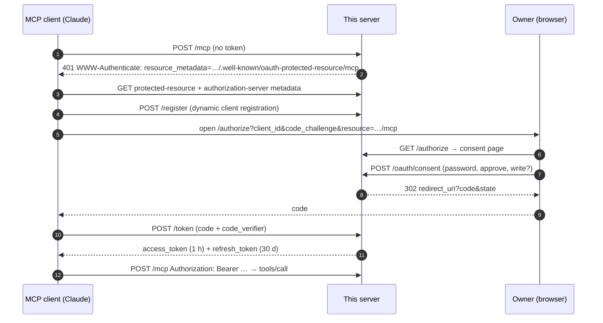

# Architecture and design decisions

## The flow

## Decisions

**The server is both authorization server and resource server.** The MCP spec allows either a separate IdP or a
combined server. Combined means one deploy, no third-party account and a flow you can read end to end — the right
default for a template and for personal or single-team connectors. The split is clean: swapping in
`ProxyOAuthServerProvider` changes the issuer without touching `/mcp` or the tools.

**Stateless Streamable HTTP.** A new `McpServer` and transport per request. The tools here are request/response, so
sessions buy nothing and cost sticky routing plus memory per client. If you need server-initiated notifications or
long-running progress streams, switch to `sessionIdGenerator: () => randomUUID()` and a session map.

**Opaque tokens, stored hashed — not JWTs.** The resource server and authorization server are the same process, so a
token lookup is a map read; JWTs would add key management and make revocation and rotation harder. Hashing means a
memory dump or a leaked database does not leak usable tokens.

**Audience binding (RFC 8707).** Every token is minted for `${PUBLIC_URL}/mcp`, and `/authorize` and `/token` reject a
`resource` that names anything else. A token issued here cannot be replayed against another MCP server that trusts the
same issuer, which is the "confused deputy" problem the MCP authorization spec calls out.

**Refresh-token rotation.** Each refresh invalidates the old refresh token *and* the access token issued with it. A
stolen refresh token stops working as soon as the legitimate client refreshes.

**Scopes checked in the tool, not only in middleware.** The bearer middleware answers "is this a valid token?". Which
tool a token may call is a domain decision, so it lives next to the tool. Denials come back as `isError` results so
the model can tell the user why, instead of surfacing a protocol error.

**The consent page is the attack surface.** It renders client-supplied data (`client_name`, `redirect_uri`) from an
unauthenticated `/register` call, so everything is HTML-escaped. It sends `X-Frame-Options: DENY` and
`frame-ancestors 'none'` against clickjacking. The pending-request id is a 256-bit single-use value, which also makes
it the CSRF token. Five wrong passwords cancel the request. There is deliberately no `form-action` CSP directive:
Chrome applies it to the redirect back to the client and would break the flow.

**Time is injected.** The provider takes a `now()` function, so tests expire codes and tokens without sleeping.

## Known limits

- In-memory state: a restart signs every client out. Fine for a template; use Redis or SQL in production.
- One owner. Multi-user needs a real identity provider; the `ownerId` already flows from token to store.
- Rate limiting is per process (the SDK's `express-rate-limit` defaults). Use a shared store if you run replicas.
